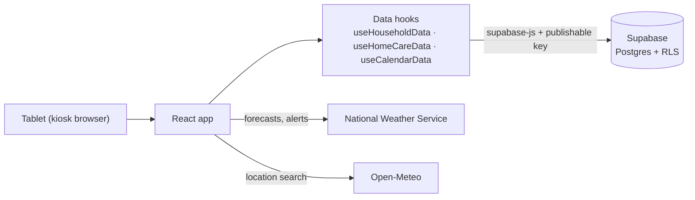

# Family Dashboard

<!-- TODO: screenshot or GIF of the dashboard on the tablet -->
<!-- TODO: link to the demo video once it exists -->

**Live site:** [family-dashboard-tan.vercel.app](https://family-dashboard-lemon-three.vercel.app/)
(sign-in required; public sign-ups are off, and a shared demo account is planned)

A wall-mounted dashboard for a family's kitchen tablet: a shared calendar, a home
maintenance tracker, and live weather on one always-on screen. It's built for real
daily use on a Fire HD 10 in kiosk mode, so it's designed for touch, glanceability from
across the room, and a single household signed in once.

## Features

- **Calendar**: month view with event chips and multi-day bands, holiday rings
  (fixed and floating holidays, Easter, Chinese New Year), seasonal monthly themes, a
  day view, add / edit / delete events with categories and the people involved, and a
  today / tomorrow reminder strip.
- **Home Care**: track household items like air and water filters, log "I changed this
  today", and keep an editable history of past changes.
- **Weather**: live National Weather Service forecasts (hourly and weekly), active
  severe-weather alerts colored by severity, animated backgrounds, and a town / ZIP
  location search. US only, since it uses NWS data.
- **Household settings**: a color theme picker in Settings. The theme and the weather
  location are saved per household and shared by every device signed in to it.

## Tech stack

| Area | Tools |
|---|---|
| Front end | React 19, TypeScript, Vite, Tailwind CSS v4 |
| Back end | Supabase: PostgreSQL, Auth, row-level security |
| Data sources | National Weather Service API, Open-Meteo geocoding |
| Icons | Lucide, Meteocons |
| Database changes | Supabase CLI migrations |

## Architecture



Widgets only talk to their data hooks. Each hook loads rows from Supabase, converts
them from the database's `snake_case` shape into the app's types, and saves changes
back, so the widgets didn't change when the data moved from mock data to the database.

## Design decisions

- **Every row belongs to a household, enforced by the database.** Each table has a
  `household_id`, and row-level security policies compare it with the signed-in user's
  household (`my_household_id()`). The publishable key is public by design; RLS is what
  keeps one household's data away from another's.
- **Composite foreign keys keep links inside one household.** A plain foreign key only
  checks that a row exists, and foreign-key checks ignore RLS. Pointing at
  `(id, household_id)` instead means an event's category, a log's item, or an event's
  person must belong to the same household.
- **Separate tables instead of arrays** for Home Care history and the people on an
  event. Postgres can then reject duplicate dates, links to people who don't exist, and
  clean up links automatically when an event or person is deleted.
- **Rules live in the database, not just the form.** Check constraints enforce a
  60-character title limit, end dates on or after start dates, and "all-day events have
  no time, timed events must have one".
- **Deletes are deliberate.** Deleting a category that events still use is refused
  (`on delete restrict`); deleting an event or a person only removes the links between
  them (`on delete cascade`).
- **Optimistic updates.** The screen changes as soon as you tap, and the save runs in
  the background, so the tablet never waits on the network for a simple change.
- **Dates are stored as dates.** History and event days use Postgres `date` columns
  matched to the device's local day, so a log at 9 PM doesn't turn into tomorrow in
  UTC.
- **Versioned migrations.** Schema changes go through numbered SQL migration files in
  `supabase/migrations/`, so the database structure is tracked in git alongside the
  code.

## Running locally

1. Install dependencies:
   ```bash
   npm install
   ```
2. Create `.env.local` in the project root with your Supabase project's values:
   ```
   VITE_SUPABASE_URL=https://<project-id>.supabase.co
   VITE_SUPABASE_PUBLISHABLE_KEY=<publishable key>
   ```
   Use the publishable key, never the secret / `service_role` key.
3. Set up the database (Supabase CLI, run through `npx`):
   ```bash
   npx supabase login
   npx supabase link
   npx supabase db push
   ```
4. Create a user in the Supabase dashboard (Authentication → Users), then fill in and
   run `supabase/new_household.sql` in the SQL Editor to create their household,
   people, calendar categories and Home Care items. Public sign-ups are turned off.
5. Start the dev server:
   ```bash
   npm run dev
   ```

## Credits

- Weather data from the [National Weather Service](https://www.weather.gov/documentation/services-web-api).
- Location search by [Open-Meteo](https://open-meteo.com/), with data from GeoNames.
- Weather icons from [Meteocons](https://github.com/basmilius/weather-icons) by Bas Milius.
- UI icons from [Lucide](https://lucide.dev/).
